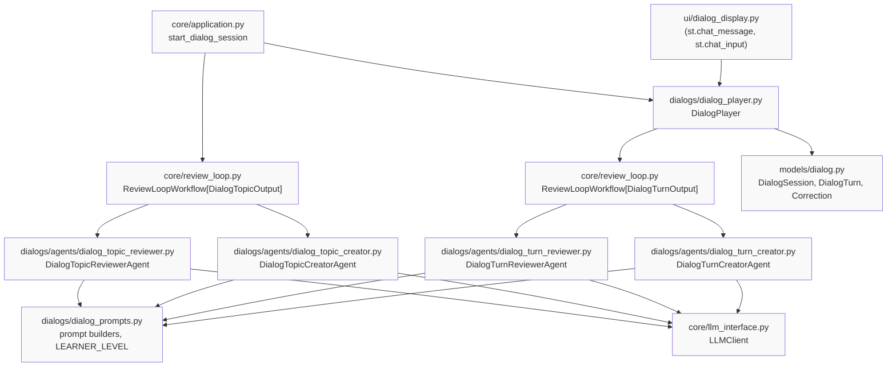
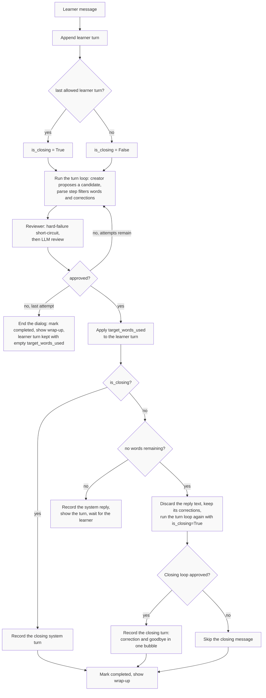

# Dialog Practice Specification

**Status**: Review
**Priority**: High
**Complexity**: High
**Intent**: `../intent/dialog-practice-intent.md`

---

## Overview

### Summary
Dialog practice is a new practice type in which the learner and the system hold a short, open-form French conversation built around 3 to 5 vocabulary words extracted from the learner's page. The system speaks at A2-B1, steers the conversation toward the target words, and corrects the learner's mistakes in French, inside the conversation. Every system turn is produced by a creator agent and checked by a reviewer agent before it is shown.

### Motivation
The existing exercise types are closed questions with one expected answer. They train recognition, not production. An A2-B1 learner needs to *use* new words in sentences of their own and be corrected while doing so. See the intent document for the full problem statement and the decisions this spec implements.

### Decisions inherited from the intent
These are fixed and are not re-opened here:

| # | Decision |
|---|----------|
| 1 | Corrections and their explanation are in French (immersion), at A2-B1 level |
| 2 | The most important error is corrected explicitly; other errors are recast in the reply |
| 3 | A dialog has 5 to 8 learner turns, or ends earlier once all target words were used |
| 4 | 3 to 5 target words per dialog, from the top of the extracted list |
| 5 | Off-topic, English or one-word learner messages are accepted, answered briefly, and steered back to a target word |
| 6 | Every dialog turn goes through the creator/reviewer workflow before display |
| 7 | Per dialog, record the target words used and the corrections made |
| 8 | Level is fixed at A2-B1, not a learner-facing setting |
| 9 | The dialog topic is fictional, invented by the model from the target words alone so that they come up naturally, and reviewed like a turn. No page text is used for it |
| 10 | The creator → reviewer → improve loop is implemented once as a generic, reusable component, because the application will need it for every kind of generated content |

---

## Requirements

### Functional Requirements
- [ ] **FR1 Dialog creation**: From the extracted vocabulary, build a dialog session with N target words (N from config, default 4) and a **dialog topic**: a fictional everyday situation, 2 to 4 French sentences at A2-B1, invented by the model from the target words alone so that each of them can be used naturally in conversation. One topic per dialog. No text from the page is used, stored or sent to the LLM; only the extracted words are.
- [ ] **FR2 Opening turn**: The system opens the dialog in French with a short message that introduces the dialog topic and asks a question inviting one target word.
- [ ] **FR3 Learner turn**: The learner types free text. The message is stored as a learner turn.
- [ ] **FR4 System turn**: For each learner message the system produces one reply in French (2 to 4 short sentences, ending in a question unless the dialog is closing) that moves the conversation toward the remaining target words.
- [ ] **FR5 Error detection and correction**: Errors in the learner message (wrong word, gender, agreement, conjugation, word order, spelling that changes meaning) are detected. At most one is corrected explicitly, as `original`, `corrected`, and a French explanation of at most 20 words. Other errors are recast in the reply.
- [ ] **FR6 No false corrections**: A correct learner message produces no correction. A correction's `original` must occur in the learner message.
- [ ] **FR7 Target word tracking**: Target words the learner used (any inflected form) are recorded on the learner turn and removed from the remaining set. A word counts as used when it appears in the learner's message in an appropriate form, including when that use was corrected and when the learner echoed a word the system offered. Target words are the forms produced by vocabulary extraction, used exactly as extracted (no lemmatisation); the creator reports each used target exactly as listed and decides whether the learner's form counts as a use of it. If the page yields two forms of the same word, they are two independent targets; one use may count for both, one or neither.
- [ ] **FR8 Steering**: The system reply uses or invites a remaining target word on every turn while any remain.
- [ ] **FR9 Off-topic handling**: English, one-word or off-topic learner messages get a brief French reply and a question that brings back a remaining target word. No correction is issued for a message written in English.
- [ ] **FR10 End condition**: The dialog ends after `DIALOG_MAX_LEARNER_TURNS` learner turns, when no target words remain, or when the reviewer does not approve a system turn within `DIALOG_MAX_TURN_ATTEMPTS`. The turn-count ending is known in advance: the last learner turn runs the loop with `is_closing=True`, so its reply closes the conversation without a question. When the words run out on an earlier turn, the reply's text is discarded, its corrections and `target_words_used` are kept, and the loop runs once more with `is_closing=True` to produce a closing turn that shows the correction and says goodbye in one bubble; when that closing loop is not approved or its LLM call fails, the closing message is skipped and the wrap-up is shown. When no candidate is approved on a reply turn, there is no final system turn and the wrap-up follows the last recorded turn directly. Every ending marks the session `COMPLETED` and shows the wrap-up.
- [ ] **FR11 Wrap-up**: After the final turn a French wrap-up lists the target words used, the target words not used, and every correction made.
- [ ] **FR12 Review before display**: Every system turn (opening, replies, closing) passes through the creator/reviewer workflow. When the reviewer rejects a candidate, the creator analyses the reviewer feedback and produces an improved candidate, which is reviewed again. The number of attempts per turn is limited by `DIALOG_MAX_TURN_ATTEMPTS`. When the limit is reached without approval, the dialog ends: the session is marked `COMPLETED` and the wrap-up is shown, and no candidate is displayed. A candidate is accepted only when the verdict is approved and the score is at least the loop's approval threshold (default 70, configurable per content type); the loop enforces this itself, so a mislabelled verdict cannot show a low-scored candidate. The dialog topic goes through the same loop with the same limit; when it is not approved, the topic is "" and the opening turn is still reviewed. The loop is one generic component shared by turns and topics (decision 10).
- [ ] **FR13 Level**: All system text, including the dialog topic, is A2-B1: short sentences, high-frequency vocabulary, present, passé composé and futur proche as default tenses. Target words are exempt.
- [ ] **FR14 Practice selection**: After vocabulary extraction the learner chooses between Exercises and Dialog practice. A new dialog can be started after one ends, using the next target words. A target word counts as practised only after the learner used it in a dialog (recorded in `target_words_used` on the learner turn); words not used stay available for the next dialog, including all words of a dialog that ends on the opening turn and words not used when a dialog ends early.
- [ ] **FR15 Progress record**: Each completed dialog is kept in the Streamlit session with its words used, words not used and corrections, for the Review phase. A dialog that ends before its opening turn is approved is not kept. When a dialog is marked `COMPLETED`, its `words_used` are added to `dialog_words_practised` in `st.session_state`; a dialog abandoned through "new dialog" is discarded and credits no words.
- [ ] **FR16 Switch**: Dialog practice can be disabled through configuration without touching exercise generation.

### Non-Functional Requirements
- [ ] **Latency**: A system turn (creator + reviewer, no retry) is shown within 10 s at p50 on `mistral-small` with the default rate limit. A spinner is shown in the chat while waiting.
- [ ] **Cost**: A system turn makes 2 LLM calls (creator, reviewer) per attempt. The turn loop runs at most `DIALOG_MAX_LEARNER_TURNS` + 1 times per dialog (opening, one run per learner turn, and one extra closing run when the words run out before the turn limit; the turn-count ending reuses the last learner turn as the closing turn), so a full dialog makes at most 2 × `DIALOG_MAX_TURN_ATTEMPTS` × (`DIALOG_MAX_LEARNER_TURNS` + 1) calls, 28 with the defaults, plus at most 2 × `DIALOG_MAX_TURN_ATTEMPTS` calls per dialog for the topic, 32 in total with the defaults.
- [ ] **Reliability**: An LLM failure on a turn is reported in the chat in French with an invitation to retry the same message. The dialog state is not corrupted.
- [ ] **Testability**: The whole dialog runs offline with `MockLLMClient`. Prompts are built by pure functions that can be unit-tested.
- [ ] **Security**: Learner text is passed to the LLM only inside the prompt. No learner text is logged at INFO level.
- [ ] **Copyright**: Dialog practice never sends page text to the LLM and never stores it. The only input taken from the page is the extracted vocabulary list. The topic and every dialog turn are invented by the model, so nothing from the page can be reproduced.
- [ ] **Usability**: Corrections are visually distinct from the reply but inside the same system bubble, so the flow of the conversation is preserved.

### Constraints
- [ ] Use the existing `LLMClient` protocol, `MistralLLMClient`, its rate limiter and `response_schema` structured output. No new LLM provider.
- [ ] No new runtime dependencies. Streamlit's `st.chat_message` and `st.chat_input` are sufficient for the UI.
- [ ] Implement the creator/reviewer loop once as a generic `ReviewLoopWorkflow` in `core/`, built on LangGraph for consistency with `ExerciseWorkflow`. Turn and topic agents are plugged into it; neither gets a loop of its own.
- [ ] Keep the three-phase flow. Dialog practice is one more option in Practice and does not change exercise generation.
- [ ] French only, text only, single user, local execution (mission scope).
- [ ] Level string is a constant in the prompt module, not a setting (decision 8).
- [ ] Structured outputs use pydantic models with `extra="forbid"`, as `LLMEvaluationOutput` does, because Mistral strict mode requires `additionalProperties: false`.

---

## User Stories

- **As a** French learner at A2-B1
  **I want to** talk with the system in a simple invented situation built around the words from the page I just read
  **So that** I use the new words in my own sentences instead of only recognising them

- **As a** French learner
  **I want to** be corrected briefly and in French when I make a mistake
  **So that** I learn the right form without leaving the conversation or switching language

- **As a** French learner
  **I want to** be nudged toward the words I have not used yet
  **So that** each dialog covers the vocabulary from the page

- **As a** French learner
  **I want to** see at the end which words I used and what was corrected
  **So that** I know what to review

- **As a** French learner who gets stuck
  **I want to** be able to answer in English or with one word without being penalised
  **So that** the conversation continues and I can try again in French

- **As a** developer
  **I want to** run a full dialog with the mock LLM
  **So that** unit tests do not need an API key

---

## Technical Design

### Architecture



### Per-turn workflow



The boxes from the creator to the approval decision are the generic `ReviewLoopWorkflow`; only the creator, the reviewer and the parse-step filtering are dialog-specific. When the loop ends without approval, the player marks the dialog completed and shows the wrap-up. The opening turn runs the same loop with an empty learner message and `is_opening=True`. The closing turn runs it with `is_closing=True`, which tells the creator to end without a question; the last learner turn is known to be the last, so it runs with `is_closing=True` directly, and when the words run out earlier the closing turn is a second loop run whose prompt carries the discarded reply's correction (see FR10).

### Components

| Component | Responsibility | Dependencies |
|-----------|---------------|--------------|
| `models/dialog.py` | Dataclasses `Correction`, `DialogTurn`, `DialogSession`, `DialogSummary`, enum `DialogRole`, `DialogStatus` | stdlib |
| `dialogs/dialog_prompts.py` | `LEARNER_LEVEL` constant, `build_creator_prompt(...)`, `build_reviewer_prompt(...)`, `build_wrap_up(session)`; loads the prompt templates and renders them with placeholder replacement; pure functions | `models/dialog.py`, `dialogs/prompts/*.txt` |
| `dialogs/prompts/*.txt` | The four LLM prompt templates (`turn_creator.txt`, `turn_reviewer.txt`, `topic_creator.txt`, `topic_reviewer.txt`) with `{placeholder}` markers | none |
| `core/review_loop.py` | `ReviewLoopWorkflow[C]`: generic LangGraph loop creator → reviewer → improve on feedback, accepting a candidate only with `approved=true` and score ≥ the loop's approval threshold (default `APPROVAL_THRESHOLD`) and ending without an approved candidate when attempts are exhausted; `Creator[C]` and `Reviewer[C]` protocols; `ReviewVerdict`; `ReviewLoopResult[C]` | LangGraph, pydantic |
| `dialogs/agents/dialog_turn_creator.py` | `DialogTurnCreatorAgent`, a `Creator[DialogTurnOutput]`: produces a candidate turn with structured output, improves it from feedback, and filters the parsed output (word normalisation and membership, correction rules) | `LLMClient`, `dialog_prompts`, pydantic |
| `dialogs/agents/dialog_turn_reviewer.py` | `DialogTurnReviewerAgent`, a `Reviewer[DialogTurnOutput]`: hard-failure short-circuit (empty or overlong reply, no LLM call), then LLM review returning a `ReviewVerdict` | `LLMClient`, `dialog_prompts`, pydantic |
| `dialogs/dialog_player.py` | `DialogPlayer`: owns a `DialogSession`, exposes `open()`, `submit_learner_message()`, `is_complete`, `summary()`; builds the turn context, maps an approved loop result to a `DialogTurn` and ends the dialog when the loop returns no approval | `ReviewLoopWorkflow`, `models/dialog.py` |
| `dialogs/agents/dialog_topic_creator.py` | `DialogTopicCreatorAgent`, a `Creator[DialogTopicOutput]`: candidate fictional topic from the target words | `LLMClient`, `dialog_prompts`, pydantic |
| `dialogs/agents/dialog_topic_reviewer.py` | `DialogTopicReviewerAgent`, a `Reviewer[DialogTopicOutput]`: checks French, level, fictional everyday situation, fit with each target word | `LLMClient`, `dialog_prompts`, pydantic |
| `core/application.py` | Builds the agents and the two loops, passing the same approval threshold (default 70) to each loop and its reviewer agent; `start_dialog_session(vocabulary_words, practised_words)` selects the first unpractised target words, runs the topic loop, returns a `DialogPlayer` | `ReviewLoopWorkflow`, topic agents, `DialogPlayer`, `config` |
| `ui/dialog_display.py` | `display_dialog(player)`: renders history, corrections, spinner, wrap-up, "new dialog" button | Streamlit, `DialogPlayer` |
| `app.py` | Practice-mode selector; keeps the dialog player, practised words and completed dialogs in `st.session_state`; adds a completed dialog's `words_used` to `dialog_words_practised` | UI modules |
| `core/mock_llm.py` | Returns valid JSON for creator and reviewer prompts; matches the dialog prompts on the shared marker constants | `dialogs/dialog_prompts` |
| `config.py` | `dialog_practice_enabled`, `dialog_words_per_dialog`, `dialog_max_learner_turns`, `dialog_max_turn_attempts` | pydantic-settings |

### Data Flow

1. **Input**: extracted vocabulary (ordered list). Target words are the forms produced by vocabulary extraction (lowercased inflected forms), used exactly as extracted; no lemmatisation is applied (the extractor's output is used as-is, so the vocabulary contract stays unchanged for every practice type), and two forms of the same word from one page are two independent targets. A word counts as practised once the learner used it in a dialog (recorded in `target_words_used` on the learner turn). `start_dialog_session(vocabulary_words, practised_words)` takes the first `dialog_words_per_dialog` words of `vocabulary_words` not in `practised_words` (the app passes `st.session_state.dialog_words_practised`), runs the topic workflow on them, and stores the approved fictional topic on the session ("" when the topic is not approved). No page text is involved.
2. **Opening**: `DialogPlayer.open()` runs the turn loop with no learner message. The approved turn is appended as the first system turn. When the opening turn is not approved, the dialog ends with zero turns: the wrap-up is shown, but the session is not recorded and no word is marked as practised (none was used), so the next dialog reuses them.
3. **Turn loop**: `submit_learner_message(text)` appends a learner turn and runs the turn loop with the full history (`is_closing=True` when this is the last allowed learner turn). On approval it applies the returned `target_words_used` to the learner turn and appends the system turn. When the loop ends without approval, the dialog is marked `COMPLETED` instead and the wrap-up is shown; the learner turn is kept, with no `target_words_used` and no corrections recorded for it. When the words run out on a non-closing turn, the reply's text is discarded, its corrections are kept, and the turn loop runs once more with `is_closing=True` (the closing prompt carries the kept correction); the closing turn is appended, or skipped when that loop is not approved or its LLM call fails, and the dialog is marked `COMPLETED` with the wrap-up.
4. **End**: the dialog ends when the learner turn count reaches the max (the last turn already ran with `is_closing=True`), when the remaining set is empty (closing turn appended as in step 3), or when a turn is not approved within `DIALOG_MAX_TURN_ATTEMPTS`. The session status becomes `COMPLETED` and `summary()` returns a `DialogSummary`.
5. **Output**: the `DialogSession` (all turns, corrections, words used) is appended to `st.session_state.completed_dialogs` for the Review phase, unless the dialog ended before its opening turn was approved, and its `words_used` are added to `st.session_state.dialog_words_practised`. A dialog abandoned through "new dialog" is discarded and credits no words.

### Prompt design

The prompt instructions are written in French; this reduces the English content in the prompt and the risk of English leaking into learner-facing text. The learner-facing text they produce is intended to be French. Structured-output field names (`approved`, `score`, `feedback`, `reply`, `corrections`, `original`, `corrected`, `explanation`, `target_words_used`, `topic`) stay English; only the instructions around them are French.

The four LLM prompt templates are stored in `dialogs/prompts/*.txt`; `dialog_prompts` loads them and replaces `{placeholder}` markers (a line that is exactly `{name}` is a block placeholder: the value's lines, or nothing when empty; other occurrences are replaced inline). The `{..._MARKER}` placeholders are the marker constants, so the mock's prompt matching cannot drift from the template text. The templates below are the content of those files.

**Creator prompt** (built by `build_creator_prompt`):

```
{TURN_CREATOR_MARKER} français sympathique pour un apprenant de niveau {LEARNER_LEVEL} (CECR).
{topic_block}

Mots cibles que l'apprenant doit pratiquer : {target_words}
Mots cibles pas encore utilisés : {words_remaining}

Règles pour ta réponse :
- Écris en français uniquement. Jamais d'anglais.
- Niveau {LEARNER_LEVEL} : phrases de 15 mots maximum, vocabulaire courant, présent,
  passé composé et futur proche. Pas de subjonctif, pas de passé simple, pas d'idiomes.
  Les mots cibles sont la seule exception.
- 2 à 4 phrases. {ending_rule}
{question_rules}

Règles pour les corrections (champ « corrections ») :
- Cherche les erreurs dans le dernier message de l'apprenant uniquement : mauvais mot,
  genre, accord, conjugaison, ordre des mots, orthographe qui change le sens.
- S'il y a des erreurs, mets la plus importante dans « corrections » avec :
  « original » (copié exactement du message de l'apprenant), « corrected » et « explanation »
  (en français, 20 mots maximum, niveau {LEARNER_LEVEL}).
- Ne liste pas les autres erreurs. Réutilise plutôt leur forme correcte naturellement dans ta réponse.
- S'il n'y a pas d'erreur, « corrections » est une liste vide. N'invente jamais d'erreur.
{carried_correction_block}

Champ « target_words_used » : les mots cibles que l'apprenant a utilisés dans le dernier
message, sous n'importe quelle forme fléchie, chacun rapporté exactement comme listé dans
les mots cibles (jamais la forme de l'apprenant). Un mot compte même si son emploi a été
corrigé, et quand l'apprenant n'a fait que répéter un mot offert par le système. Liste vide
si aucun.

Conversation jusqu'ici :
{history}
{learner_message_block}
{reviewer_feedback_block}
```

`{topic_block}` vaut « Sujet de la conversation : » suivi du sujet approuvé, ou la ligne générique `GENERIC_TOPIC_LINE` quand aucun sujet n'a été approuvé. `ending_rule` vaut « Termine par une question. » pour les tours normaux, « Commence la conversation par une salutation et une question. » pour le tour d'ouverture, et « Termine la conversation chaleureusement. Ne pose pas de question. » pour le tour de clôture. `question_rules` vaut les deux règles « Utilise un des mots pas encore utilisés, ou pose une question qui invite l'apprenant à l'utiliser. » et « Si l'apprenant a écrit en anglais, répondu par un seul mot ou est hors sujet : réponds brièvement, ne corrige pas, et pose une question qui ramène un mot pas encore utilisé. » sur les tours normaux et d'ouverture ; il est vide sur un tour de clôture, où ces deux règles contrediraient « Ne pose pas de question ». Quand `{words_remaining}` est vide, la ligne affiche « aucun » (comme dans le wrap-up). `carried_correction_block` est vide, sauf sur un tour de clôture qui répond à un message de l'apprenant (les mots sont épuisés), où il vaut « Correction à montrer d'abord : {original} → {corrected} : {explanation}. Ne la remets pas dans « corrections » : ce champ doit être une liste vide. » : la correction portée est déjà montrée à l'apprenant, donc le créateur renvoie `corrections: []` sur ce tour (l'étape de filtrage du parseur écarte toutes les corrections dans ce cas, voir le tableau ci-dessous). `learner_message_block` vaut une ligne vide suivie de « Dernier message de l'apprenant : « {learner_message} » » quand il y a un message de l'apprenant, et est vide au tour d'ouverture. `reviewer_feedback_block` est vide à la première tentative. Aux tentatives suivantes, il vaut « Un relecteur a rejeté ta réponse précédente. Réponse précédente : {previous_reply}. Corrections précédentes : {previous_corrections}. Commentaire du relecteur : {feedback}. Analyse le commentaire, garde ce qui était juste, corrige ce qui était faux, et produis une réponse améliorée. » La ponctuation finale de `{explanation}`, `{previous_reply}`, `{previous_topic}` et `{feedback}` est retirée avant le point ajouté, pour ne jamais doubler la ponctuation.

**Reviewer prompt** (built by `build_reviewer_prompt`):

```
{TURN_REVIEWER_MARKER} d'une conversation française pour un apprenant de niveau {LEARNER_LEVEL}.

Dernier message de l'apprenant : « {learner_message} »
Mots cibles : {target_words}. Pas encore utilisés avant ce tour : {words_remaining}
Réponse candidate : « {reply} »
Corrections candidates : {corrections_json}

Vérifie, dans cet ordre :
1. Chaque correction est linguistiquement correcte, l'« original » est vraiment une erreur,
   et la forme « corrected » est juste. Une correction fausse ou inutile vaut score 0.
2. La réponse est en français uniquement.
3. La réponse est au niveau {LEARNER_LEVEL} : phrases courtes, mots courants, pas de
   subjonctif ni de passé simple.
4. La réponse {ending_check}.
5. La réponse utilise ou invite un mot pas encore utilisé, s'il en reste.

Réponds avec approved (true seulement si score >= {approval_threshold} et la vérification 1
est passée), score (0-100) et feedback (en français, une ou deux phrases indiquant quoi corriger).
```

`ending_check` vaut « se termine par une question » pour les tours normaux et d'ouverture, et « termine la conversation sans poser de question » pour le tour de clôture. `{learner_message}` vaut « (aucun) » au tour d'ouverture. Quand `{words_remaining}` est vide, la fin de la ligne affiche « aucun ». `{approval_threshold}` is the threshold configured on the loop (default 70); it appears in both reviewer prompts. The reviewer agents receive the same value and the loop enforces it, so the prompt and the enforcement cannot drift apart. The reviewer does not score `target_words_used`: it is bookkeeping the learner never sees, and a borderline word-tracking call must not be able to end the dialog. Word tracking is the creator's proposal, filtered deterministically in its parse step (see below).

**Topic creator prompt** (built by `build_topic_creator_prompt`, `temperature=0.7`, `max_tokens=250`):

```
{TOPIC_CREATOR_MARKER} d'une courte conversation française pour un apprenant de niveau {LEARNER_LEVEL} (CECR).
La conversation doit permettre à l'apprenant d'utiliser ces mots cibles : {target_words}

Invente une situation simple, fictive et quotidienne dans laquelle chaque mot cible apparaît
naturellement, et décris-la en 2 à 4 phrases en français qu'un partenaire de conversation
peut utiliser pour ouvrir et diriger la conversation. Tutoie l'apprenant.
- La situation est fictive : pas de vraies personnes, de vraies organisations, de vrais
  lieux d'actualité, ni d'événements actuels.
- Préfère les situations de la vie quotidienne : famille, maison, école, travail, courses,
  voyages, météo, vacances, nourriture, santé, loisirs.
- Niveau {LEARNER_LEVEL} : phrases de 15 mots maximum, vocabulaire courant de la vie
  quotidienne, présent et passé composé uniquement. Pas de subjonctif, pas de passé simple,
  pas d'idiomes, pas de mots techniques ou rares sauf les mots cibles.
{reviewer_feedback_block}
```

Output schema `DialogTopicOutput`: `topic: str`. `reviewer_feedback_block` follows the same pattern as for turns.

**Topic reviewer prompt** (built by `build_topic_reviewer_prompt`, `temperature=0.3`, `max_tokens=200`):

```
{TOPIC_REVIEWER_MARKER} d'une conversation française pour un apprenant de niveau {LEARNER_LEVEL}.
Mots cibles : {target_words}
Sujet candidat : « {topic} »

Vérifie, dans cet ordre :
1. Le sujet est en français uniquement.
2. Le sujet est une situation fictive de la vie quotidienne : pas de vraies personnes,
   organisations, lieux d'actualité, ni événements actuels.
3. Le sujet est au niveau {LEARNER_LEVEL} : 15 mots maximum par phrase, mots courants,
   pas de subjonctif ni de passé simple, pas de mots rares ou techniques sauf les mots cibles.
4. Chaque mot cible a une place naturelle dans une conversation sur ce sujet.
5. Le sujet fait 2 à 4 phrases.

Réponds avec approved (true seulement si score >= {approval_threshold}), score (0-100) et
feedback (en français, une ou deux phrases indiquant quoi corriger).
```

The reviewer output is the shared `ReviewVerdict`. The topic runs through the same `ReviewLoopWorkflow` as turns: reject → creator improves from feedback → review, up to `DIALOG_MAX_TURN_ATTEMPTS`. If the reviewer never approves or every call fails, the topic is "" and the turn creator prompt line for the topic reads « Sujet : choisis une situation simple de la vie quotidienne dans laquelle les mots cibles s'intègrent naturellement. »

**Creator parse-step filtering** (run when the creator parses the model's answer; the context gives it the learner message, so no candidate mutation is needed):

| Rule | Action |
|------|--------|
| Each proposed target word is normalised (Unicode NFC, lowercase) and must be in the target set | Drop words not in the target set |
| `correction.original` is not a case-insensitive substring of the learner message | Drop that correction |
| More than one correction | Keep the first, drop the rest |
| Opening turn has corrections | Drop all corrections |
| Closing turn | Corrections are allowed only for the learner message it answers (the rules above apply) |
| Closing turn carrying a correction (the discarded reply's correction is shown first) | Drop all corrections: the carried correction is already shown, so `corrections` must be empty |

Whether the learner's inflected form counts as a use of a target is the creator's judgment; there is no prefix-matching rule, because irregular forms (prévenir → prévient, boire → bu) share no five-character prefix with their dictionary form.

**Reviewer hard-failure short-circuit** (run in the reviewer node before the LLM call, mirroring the trivial checks of `ExerciseReviewerAgent`):

| Check | Action |
|-------|--------|
| Reply is empty or has more than 6 sentences | Reject with feedback, no LLM call |

**Wrap-up** (`build_wrap_up`, no LLM call, fixed French template):

```
Bravo, la conversation est terminée !
Mots utilisés : {words_used}
Mots à revoir : {words_not_used}
Corrections :
- « {original} » → « {corrected} » : {explanation}
```

### Feedback loop

| Situation | Behaviour |
|-----------|-----------|
| Reviewer approves (`approved=true` and score ≥ the approval threshold, default 70) | Turn is shown |
| Reviewer rejects, attempts < `dialog_max_turn_attempts` | The candidate and its score are kept in state. The creator runs again with the previous candidate and the reviewer feedback in the prompt and returns an improved candidate |
| Reviewer rejects on the last attempt | The dialog ends: the session is marked `COMPLETED` and the wrap-up is shown. No candidate is displayed and no LLM call is made. The learner turn is kept in the session, but no system turn is appended, so its `target_words_used` and corrections are not recorded and its words appear under « Mots à revoir » in the wrap-up |
| The closing loop (words ran out) is not approved or its LLM call fails | The closing message is skipped: the session is marked `COMPLETED` and the wrap-up is shown. The reply text was already discarded; its `target_words_used` stay applied to the learner turn |
| LLM raises on a reply-loop call | The learner turn is removed from the session, an error line in French is shown ("Désolé, il y a eu un problème. Réessaie ton message.") and the learner can resend |

The loop enforces the threshold itself: a verdict with `approved=true` but a score below the threshold is treated as a rejection, so a low-scored candidate is never shown even if the reviewer mislabels it.

### UI layout

```
French Language Learner Assistant
[URL input] [Extract Vocabulary and Create Exercises]

Vocabulary: ...

Practice mode:  ( ) Exercises   (•) Dialog

┌ Dialog 1 · words: canicule, sécheresse, prévenir, chaleur ─────────┐
│ 🤖  Bonjour ! Cette semaine il fait très chaud en France.          │
│     Est-ce qu'il y a une canicule chez toi ?                       │
│ 🧑  Oui, il fait beaucoup de chaleur. Le gouvernement prévient     │
│     les gens pour boire de l'eau.                                  │
│ 🤖  ✏️ « prévient les gens pour boire » → « prévient les gens de   │
│        boire » : après « prévenir quelqu'un », on utilise « de ».  │
│     Presque ! Et il y a de la sécheresse dans ta région ?          │
│ Turn 1/6 · words left: sécheresse                                  │
└────────────────────────────────────────────────────────────────────┘
[Écris ta réponse en français…                                      ]
```

When the dialog completes, the wrap-up is shown as a final system message and a button "Nouveau dialogue" starts the next dialog with the next target words (the first words not used yet; the same words again when the dialog ended before its opening turn was approved). If no words remain, the button is replaced by a message saying all words from the page were practised.

---

## API/Interfaces

### Public Classes and Functions

```python
# dialogs/dialog_player.py
class DialogPlayer:
    def __init__(
        self, session: DialogSession, turn_loop: ReviewLoopWorkflow[DialogTurnOutput]
    ) -> None: ...

    def open(self) -> DialogTurn | None:
        """Run the opening system turn. Returns None when the reviewer does not
        approve within the attempt limit; the dialog is then COMPLETED.
        Raises DialogTurnError on LLM failure."""

    def submit_learner_message(self, text: str) -> DialogTurn | None:
        """Record the learner message, run the turn loop, return the system turn.
        Returns None when the reviewer does not approve within the attempt
        limit; the dialog is then COMPLETED and the wrap-up is shown.
        Raises ValueError if the dialog is complete or text is blank.
        Raises DialogTurnError on LLM failure; the learner turn is not kept."""

    @property
    def is_complete(self) -> bool: ...

    def summary(self) -> DialogSummary:
        """Words used, words not used, corrections. Valid at any time."""


# core/application.py (addition)
def start_dialog_session(
    self, vocabulary_words: list[str], practised_words: set[str]
) -> DialogPlayer:
    """Select the first `dialog_words_per_dialog` words of `vocabulary_words` not in
    `practised_words`, run the topic loop on them and return a ready DialogPlayer."""


def create_dialog_topic(self, target_words: list[str]) -> str:
    """Run the topic loop. Returns a fictional situation of 2 to 4
    French sentences at A2-B1 built around the target words, or "" when the
    reviewer never approves or the LLM fails. Called by start_dialog_session."""


# core/review_loop.py  (generic, reusable by any generated content)
APPROVAL_THRESHOLD = 70  # default approval bar; ReviewLoopWorkflow takes approval_threshold to override it per content type


class ReviewVerdict(BaseModel):
    """Reviewer output. Also the JSON schema handed to LLM reviewers."""

    model_config = ConfigDict(extra="forbid")
    approved: bool
    score: int = Field(..., ge=0, le=100)
    feedback: str


class Creator[C](Protocol):
    def create(self, context: Any, previous: C | None, feedback: str | None) -> C:
        """First attempt: previous and feedback are None. Later attempts: improve
        `previous` using the reviewer `feedback`. Raises on LLM failure."""


class Reviewer[C_contra](Protocol):
    def review(self, context: Any, candidate: C_contra) -> ReviewVerdict:
        """May run deterministic checks first and skip the LLM on a hard failure."""


@dataclass
class ReviewLoopResult[C]:
    candidate: C | None  # None when no candidate was approved
    verdict: ReviewVerdict | None  # None together with candidate
    attempts: int
    approved: bool  # False when the attempt limit was reached without approval
    candidates: list[tuple[C, ReviewVerdict]]  # every attempt, in order


class ReviewLoopWorkflow[C]:
    def __init__(
        self,
        creator: Creator[C],
        reviewer: Reviewer[C],
        max_attempts: int = 2,
        approval_threshold: int = APPROVAL_THRESHOLD,
    ) -> None: ...

    def run(self, context: Any) -> ReviewLoopResult[C]:
        """LangGraph StateGraph: creator → reviewer → (approved with score >=
        the loop's approval_threshold → END | rejected and attempt < max_attempts →
        creator | else exhausted → END with approved=False and candidate=None)."""


# dialogs/agents/dialog_turn_creator.py
@dataclass
class DialogTurnContext:
    session: DialogSession
    learner_message: str | None  # None means opening turn
    is_closing: bool
    carried_corrections: list[Correction] = field(
        default_factory=list
    )  # closing turn only: the discarded reply's corrections


class DialogTurnCreatorAgent:  # implements Creator[DialogTurnOutput]
    def __init__(self, llm_client: LLMClient) -> None: ...
    def create(
        self,
        context: DialogTurnContext,
        previous: DialogTurnOutput | None,
        feedback: str | None,
    ) -> DialogTurnOutput:
        """One LLM call with structured output, then parse-step filtering of the
        parsed candidate (word normalisation and membership, correction rules).
        Raises DialogTurnError on invalid JSON."""


# dialogs/agents/dialog_turn_reviewer.py
class DialogTurnReviewerAgent:  # implements Reviewer[DialogTurnOutput]
    def __init__(self, llm_client: LLMClient, approval_threshold: int = 70) -> None: ...
    def review(
        self, context: DialogTurnContext, candidate: DialogTurnOutput
    ) -> ReviewVerdict:
        """Hard-failure short-circuit (empty or overlong reply, no LLM call), then
        one LLM review call. Does not score `target_words_used`."""


# dialogs/agents/dialog_topic_creator.py / dialog_topic_reviewer.py
# Same shape with context `list[str]` (target words) and candidate `DialogTopicOutput`;
# the topic reviewer also takes `approval_threshold: int = 70`.


# dialogs/dialog_prompts.py
# The four LLM prompt templates live in dialogs/prompts/*.txt; the builders
# load and render them with placeholder replacement (see Prompt design).
LEARNER_LEVEL = "A2-B1"


def build_creator_prompt(
    session: DialogSession,
    learner_message: str | None,
    is_closing: bool,
    reviewer_feedback: str | None = None,
    carried_corrections: list[Correction] | None = None,
    previous_reply: str | None = None,
    previous_corrections: list[Correction] | None = None,
) -> str: ...


def build_reviewer_prompt(
    session: DialogSession,
    learner_message: str | None,
    candidate: DialogTurnOutput,
    is_closing: bool,
    approval_threshold: int = 70,
) -> str: ...


def build_wrap_up(session: DialogSession) -> str: ...


def build_topic_creator_prompt(
    target_words: list[str],
    reviewer_feedback: str | None = None,
    previous_topic: str | None = None,
) -> str: ...


def build_topic_reviewer_prompt(
    target_words: list[str], candidate: DialogTopicOutput, approval_threshold: int = 70
) -> str: ...


# ui/dialog_display.py
def display_dialog(player: DialogPlayer) -> bool:
    """Render the dialog. Returns True when the dialog just completed."""
```

### Data Models

```python
# models/dialog.py
from dataclasses import dataclass, field
from datetime import datetime
from enum import Enum


class DialogRole(Enum):
    SYSTEM = "system"
    LEARNER = "learner"


class DialogStatus(Enum):
    IN_PROGRESS = "in_progress"
    COMPLETED = "completed"


@dataclass
class Correction:
    original: str  # exact substring of the learner message
    corrected: str
    explanation: str  # French, at most 20 words


@dataclass
class DialogTurn:
    role: DialogRole
    text: str
    corrections: list[Correction] = field(default_factory=list)  # system turns only
    target_words_used: list[str] = field(default_factory=list)  # learner turns only
    review_score: int | None = None  # system turns only


@dataclass
class DialogSession:
    dialog_id: str
    target_words: list[str]
    dialog_topic: str  # fictional, model-written, reviewed
    max_learner_turns: int
    turns: list[DialogTurn] = field(default_factory=list)
    status: DialogStatus = DialogStatus.IN_PROGRESS
    start_time: datetime = field(default_factory=datetime.now)
    end_time: datetime | None = None

    @property
    def learner_turn_count(self) -> int: ...
    @property
    def words_used(self) -> list[str]: ...  # order of first use
    @property
    def words_remaining(self) -> list[str]: ...


@dataclass
class DialogSummary:
    words_used: list[str]
    words_not_used: list[str]
    corrections: list[Correction]
    learner_turns: int
```

Structured LLM outputs (pydantic, in the agent modules):

```python
class CorrectionOutput(BaseModel):
    model_config = ConfigDict(extra="forbid")
    original: str
    corrected: str
    explanation: str


class DialogTurnOutput(BaseModel):
    model_config = ConfigDict(extra="forbid")
    reply: str
    corrections: list[CorrectionOutput]
    target_words_used: list[str]


class DialogTopicOutput(BaseModel):
    model_config = ConfigDict(extra="forbid")
    topic: str


# Reviewer output for both turns and topics: `ReviewVerdict` from core/review_loop.py
```

Generic loop state (in `core/review_loop.py`, not dialog-specific):

```python
class ReviewLoopState(TypedDict):
    context: Any
    candidate: Any | None
    verdict: ReviewVerdict | None
    candidates: Annotated[
        list[tuple[Any, ReviewVerdict]], add
    ]  # every attempt, in order
    attempt: int
```

### Configuration

| Variable | Type | Required | Default | Description |
|----------|------|----------|---------|-------------|
| `DIALOG_PRACTICE_ENABLED` | bool | No | true | Show the Dialog option in practice mode |
| `DIALOG_WORDS_PER_DIALOG` | int | No | 4 | Target words per dialog (decision 4: 3 to 5) |
| `DIALOG_MAX_LEARNER_TURNS` | int | No | 6 | Learner turns before the closing turn (decision 3: 5 to 8) |
| `DIALOG_MAX_TURN_ATTEMPTS` | int | No | 2 | Creator attempts per turn before the dialog ends without an approved turn |

The level is not configurable (decision 8). It is the constant `LEARNER_LEVEL = "A2-B1"` in `dialogs/dialog_prompts.py`.

Note on `EXERCISE_TYPES`: the intent suggested switching dialog practice like the other exercise types. Adding a `dialog` value to `ExerciseType` would make `ExerciseCreatorAgent` try to generate it and fall back to fill-in-the-blank, so a separate boolean is used instead.

---

## Implementation Plan

### Steps
- [ ] **Step 1: Models and configuration**
  - [x] Add `models/dialog.py` with the dataclasses and enums above
  - [ ] Add the four settings to `config.py` and document them in `INSTRUCTIONS.md` and `specs/tech-stack.md` (settings added; documentation lands with Step 8)
  - [x] Unit tests for `DialogSession` properties (`learner_turn_count`, `words_used`, `words_remaining`)
- [ ] **Step 2: Prompts and creator agent**
  - [x] Add `dialogs/dialog_prompts.py` with `LEARNER_LEVEL`, the turn builders, the topic builders and `build_wrap_up`; the four prompts are written in French, reducing the English content in the prompt (structured-output field names stay English); the creator prompt states that target words are returned exactly as listed, and the closing prompt carries the discarded reply's correction
  - [x] Add `dialogs/agents/dialog_turn_creator.py` with `DialogTurnOutput` and the creator node (one `generate` call with `response_schema`, `temperature=0.7`, `max_tokens=300`), including the parse-step filtering (word normalisation and membership, correction rules)
  - [x] Unit tests: prompt contains level, target words, remaining words, history, ending rule per turn kind; creator parses valid JSON and raises `DialogTurnError` on invalid JSON; the word filter keeps listed forms, drops unlisted ones and normalises case and accents (targets `prévenir`/`boire` against "prévient" and "bu")
- [ ] **Step 3: Generic review loop, reviewer agents**
  - [x] Add `core/review_loop.py`: `ReviewVerdict`, `Creator` and `Reviewer` protocols, `ReviewLoopResult`, `ReviewLoopWorkflow` as a LangGraph StateGraph with a conditional edge back to the creator while rejected and `attempt < max_attempts`, ending without an approved candidate otherwise, with a configurable `approval_threshold` (default 70)
  - [x] Unit tests for the loop with stub creator and reviewer (no LLM): approve on first attempt; reject then approve, with `previous` and `feedback` passed to the second `create`; all attempts rejected then `approved=False` with `candidate=None`; `approved=true` with a score below the threshold treated as a rejection; a custom `approval_threshold` enforced; creator exception propagates
  - [x] Add `dialogs/agents/dialog_turn_reviewer.py` with the hard-failure short-circuit (empty or overlong reply, no LLM call) and the LLM review (`temperature=0.3`, `max_tokens=200`); it does not score `target_words_used`
  - [ ] Add `dialogs/agents/dialog_topic_creator.py` and `dialog_topic_reviewer.py`; unit tests with `MockLLMClient` for each agent, plus one end-to-end topic loop test that returns "" when the LLM raises or the reviewer never approves
- [ ] **Step 4: Player and application wiring**
  - [ ] Add `dialogs/dialog_player.py`: the last learner turn runs with `is_closing=True` directly; when the words run out earlier, the reply text is discarded, its corrections are carried into a closing loop run, and the closing turn is skipped when that loop fails
  - [ ] Add `start_dialog_session(vocabulary_words, practised_words)` to `LanguageLearnerApplication`
  - [ ] Unit tests: full dialog with `MockLLMClient`, end by turn count, end by all words used (closing turn shown, reply text discarded), end when the reviewer never approves, closing loop failure skips the closing message, blank message rejected, LLM failure leaves session unchanged
- [ ] **Step 5: Mock LLM**
  - [x] Extend `MockLLMClient.generate` to recognise the topic creator prompt (marker "Tu prépares le sujet"), the topic reviewer prompt (marker "Tu examines le sujet"), the turn creator prompt (marker "Tu es un partenaire de conversation") and the turn reviewer prompt (marker "Tu examines un tour") and return valid JSON for each; each marker is a unique substring of its prompt (the turn creator marker needs the "Tu es un" prefix because the topic creator prompt also mentions "partenaire de conversation"); make the reviewer verdict overridable via the existing `responses` dict so tests can force a rejection
- [ ] **Step 6: UI**
  - [ ] Add `ui/dialog_display.py` using `st.chat_message`, `st.chat_input`, `st.spinner`
  - [ ] In `app.py`: add the practice-mode radio; keep `st.session_state.dialog_player`, `st.session_state.completed_dialogs` and `st.session_state.dialog_words_practised`
  - [ ] Test in the style of `tests/test_streamlit_display.py`: a full dialog produces non-empty French turns and a summary
- [ ] **Step 7: Integration and manual testing**
  - [ ] Integration test with the real Mistral client (see Testing Strategy)
  - [ ] Manual test script below
- [ ] **Step 8: Documentation**
  - [ ] Add dialog practice to the In Scope list of `specs/mission.md` and mark roadmap Feature Question 4 as decided
  - [ ] Add a note to `specs/feat-ui-review-phase-spec.md` that completed dialogs are available for display
  - [ ] Update `README.md` usage section

---

## Acceptance Criteria

### Must Have
- [ ] AC1: With the mock LLM, a dialog with 4 target words and max 6 learner turns runs from opening to wrap-up with no API key.
- [ ] AC2: Every system turn shown to the learner has passed the reviewer. When the reviewer rejects on the last attempt, the dialog ends and no candidate is shown.
- [ ] AC3: With the real client, the message "Le gouvernement prévient les gens pour boire de l'eau" during a dialog whose target words include *prévenir* produces exactly one correction whose `corrected` contains "de boire" and whose `explanation` is French.
- [ ] AC4: With the real client, a correct learner message ("Il n'y a pas de pluie depuis deux mois.") produces no correction in at least 4 of 5 runs.
- [ ] AC5: A learner message in English produces a French reply, no correction, and a question.
- [ ] AC14: With the real client, the message "Oui, il fait beaucoup de chaleur. Le gouvernement prévient les gens pour boire de l'eau." during a dialog whose target words include *chaleur* and *prévenir* records `target_words_used` containing both words.
- [ ] AC6: The dialog ends after `DIALOG_MAX_LEARNER_TURNS` learner turns, earlier when all target words were used, and when the reviewer does not approve a turn within `DIALOG_MAX_TURN_ATTEMPTS`.
- [ ] AC7: The wrap-up lists words used, words not used and all corrections, in French.
- [ ] AC8: The Exercises path is unchanged: all existing tests pass.
- [ ] AC9: `DIALOG_PRACTICE_ENABLED=false` hides the practice-mode selector and the app behaves as before.
- [ ] AC10: `ruff check` and `ruff format --check` pass.

### Should Have
- [ ] AC11: p50 system-turn latency under 10 s with `mistral-small` (measured manually over one dialog).
- [ ] AC12: System replies contain no English words in 10 of 10 turns of a manual dialog.
- [ ] AC13: The dialog topic for the words of a manually chosen page is in French, describes a fictional everyday situation, has 2 to 4 sentences of at most 15 words each, uses no subjunctive or passé simple, and gives each target word a natural place in the conversation.

### Test Cases
- [x] TC1 `DialogSession.words_remaining` shrinks as learner turns record `target_words_used`, and never contains a word twice.
- [x] TC2 `build_creator_prompt` for the opening turn contains the greeting rule and no learner message; for the closing turn contains the closing rule.
- [x] TC21 The four LLM prompt templates are stored in `dialogs/prompts/*.txt`; the builders load them with `importlib.resources` and replace `{placeholder}` markers (a line that is exactly `{name}` is a block placeholder, replaced by the value's lines or dropped when empty).
- [x] TC3 Creator node raises `DialogTurnError` when the LLM returns non-JSON.
- [x] TC4 Creator parse step drops a correction whose `original` is not in the learner message.
- [x] TC5 Creator parse step keeps only the first of two corrections.
- [x] TC6 Creator parse step drops all corrections on the opening turn, and keeps the answered message's correction on a closing turn.
- [x] TC20 Creator parse step normalises proposed target words (Unicode NFC, lowercase) and keeps only words in the target set: with targets `prévenir`/`boire`, a proposal of `prévenir` is kept, `prévient` (the learner's form) is dropped, and `Boire` is normalised to `boire`.
- [ ] TC7 `ReviewLoopWorkflow` returns the candidate on approval with `attempts=1` and `approved=True`; the player sets `review_score` from the verdict.
- [ ] TC8 `ReviewLoopWorkflow`, on rejection, calls `create` again with the previous candidate and the feedback, and returns the second candidate when approved with `attempts=2`.
- [ ] TC9 `ReviewLoopWorkflow`, after `max_attempts` rejections, returns `approved=False` with `candidate=None`; the player marks the dialog `COMPLETED` and shows the wrap-up.
- [ ] TC10 Player refuses a blank message and a message after completion.
- [ ] TC11 Player leaves the session unchanged when the turn loop raises.
- [ ] TC12 `start_dialog_session` takes exactly `dialog_words_per_dialog` words and fewer when fewer unpractised words remain.
- [x] TC13 `build_wrap_up` lists every correction and both word lists.
- [ ] TC15 `create_dialog_topic` returns "" on LLM error or when the topic is not approved, and `build_creator_prompt` falls back to the generic topic line when the topic is empty.
- [x] TC16 `build_topic_creator_prompt` contains the level constant, every target word, the sentence-length limit and the fictional-situation rule; `build_topic_reviewer_prompt` contains every target word and the fit check.
- [ ] TC17 Topic loop end to end with `MockLLMClient`: approved topic returned; "" returned when the LLM raises or the reviewer never approves.
- [ ] TC18 Integration: the topic for 4 fixed target words has 2 to 4 sentences, none longer than 15 words, and the reviewer approves it.
- [ ] TC14 Integration: AC3, AC4, AC5, AC14 against Mistral, marked `integration`.
- [ ] TC19 Player ends the dialog (status `COMPLETED`, wrap-up shown, no system turn appended, learner turn kept with empty `target_words_used`) when the turn loop returns no approval.

---

## Dependencies

### Internal Dependencies
- [ ] Vocabulary extraction: `web/vocabulary_extractor.py` provides the ordered word list (`specs/feat-vocabulary-extraction-spec.md`). Its text and data mining opt-out (Step 5 of that spec) governs the fetch and applies to all practice types alike; dialog practice adds no page-text use of its own
- [ ] LLM layer: `core/llm_interface.py`, `core/llm_client.py` (structured output, rate limiter), `core/mock_llm.py`
- [ ] Configuration: `config.py`
- [ ] Practice UI: `app.py` (`specs/feat-ui-practice-phase-spec.md`)
- [ ] Review phase: consumes `completed_dialogs` (`specs/feat-ui-review-phase-spec.md`)
- [ ] Exercise generation spec, Stage 3 (external prompts): the dialog builders already read their templates from `dialogs/prompts/*.txt`; when `PromptLoader` lands, it should serve those templates (and the exercise prompts from `prompts/dialog/`). Not a blocker.

### External Dependencies
- [ ] `streamlit` 1.55.0: `st.chat_message`, `st.chat_input` (available since 1.24)
- [ ] `langgraph`: `StateGraph`, conditional edges
- [ ] `pydantic`: structured output models
- [ ] `mistralai`: `json_schema` response format (already used by `AnswerEvaluator`)

### Blocking Issues
- None.

---

## Testing Strategy

### Unit Tests
- [x] `tests/test_dialog_models.py`: TC1
- [x] `tests/test_dialog_prompts.py`: TC2, TC13, TC16
- [x] `tests/test_dialog_turn_creator.py`: TC3, JSON parsing, TC4, TC5, TC6, TC20 (parse-step filtering)
- [x] `tests/test_dialog_turn_reviewer.py`: hard-failure short-circuit (empty or overlong reply, no LLM call)
- [x] `tests/test_review_loop.py`: TC7, TC8, TC9 with stub creator and reviewer, no LLM
- [ ] `tests/test_dialog_player.py`: TC10, TC11, TC12, TC19, full mock dialog (AC1)

### Integration Tests
- [ ] `tests/integration/test_dialog_practice_integration.py` using the `real_llm_client` fixture: one dialog of 3 learner turns with the messages from AC3, AC4 and AC5; assert correction presence/absence, French reply (no token from a small English stop-word list: "the", "is", "you", "and", "to"), reply ends with "?" on non-closing turns, and the AC3 message records `target_words_used` containing `chaleur` and `prévenir` (AC14).

### Manual Testing
- [ ] Extract vocabulary from a French news article and choose Dialog; check the topic is a fictional everyday situation in French at A2-B1 (short sentences, everyday words, no subjunctive or passé simple) in which the target words fit naturally, and that it does not retell the article. Then and complete one dialog with deliberate errors (gender, agreement, missing "de"); check each correction is right and in French.
- [ ] Answer one turn in English and one with a single word; check the reply stays in French and asks a question with a remaining word.
- [ ] Use all target words within 3 turns; check the dialog closes early with a closing turn (correction and goodbye in one bubble) and a wrap-up.
- [ ] Complete two dialogs from the same page; check the second uses the words the first dialog did not use.
- [ ] End a dialog early because the reviewer never approves a turn; check the wrap-up lists the words not used and the next dialog starts with those words.
- [ ] Set `DIALOG_PRACTICE_ENABLED=false`; check the selector is gone.
- [ ] Kill network mid-dialog; check the French error line appears and the message can be resent.

### Test Data
- Target words: `["canicule", "sécheresse", "prévenir", "chaleur"]`; dialog topic: two French sentences about a heat wave, written for the test (not taken from a page).
- Mock topic JSON: `{"topic": "Tu passes l'été chez ta grand-mère à la campagne. Il fait très chaud et il n'a pas plu depuis des semaines."}`
- Learner messages with known errors and their expected corrections:

| Learner message | Expected `corrected` contains |
|-----------------|-------------------------------|
| Le gouvernement prévient les gens pour boire de l'eau. | de boire |
| La chaleur est très fort. | forte |
| Je suis allé au marché et j'ai acheté des pomme. | pommes |

- Mock creator JSON: `{"reply": "Il fait chaud aujourd'hui. Est-ce qu'il y a une canicule chez toi ?", "corrections": [], "target_words_used": []}`
- Mock reviewer JSON: `{"approved": true, "score": 85, "feedback": "Fine."}`

---

## Risks & Mitigations

| Risk | Probability | Impact | Mitigation |
|------|-------------|--------|------------|
| Wrong or unnecessary correction shown to the learner | Medium | High | Reviewer check 1 scores 0 on any wrong correction, so such a candidate is not approved and never shown; deterministic substring check |
| Dialog ends early when the reviewer rejects on every attempt of one turn | Medium | Medium | `DIALOG_MAX_TURN_ATTEMPTS` defaults to 2 and the reviewer scores 0 on doubtful corrections; the wrap-up still lists words used and corrections, unpractised words stay available for the next dialog, and the exhaustion is logged as a warning |
| English leaks into system replies | Medium | Medium | French prompts (reduced English content in the prompt), creator rule, reviewer check 2, integration assertion |
| Reply above A2-B1 | Medium | Medium | Explicit tense and sentence-length rules, reviewer check 3 |
| Dialog topic above A2-B1 or too far from the target words | Medium | Medium | Explicit level and fit rules in the creator prompt; reviewer checks 3 and 4; AC13 and TC18 |
| Mistral ignores or malforms the JSON schema | Low | High | Strict `json_schema` mode already proven in `AnswerEvaluator`; parse failure raises `DialogTurnError`, learner can resend |
| Latency of 2 to 3 calls per turn with 0.8 calls/s rate limit | High | Medium | Spinner in chat; dialogs are short; `max_tokens` kept small; measured in AC11 |
| Learner never uses target words, dialog drags | Medium | Low | Hard cap on learner turns; steering rule every turn |
| Inflected target words not recognised as used | Medium | Low | The creator judges whether an inflected form counts and reports the target exactly as listed; the parse step normalises (NFC, lowercase) and keeps only listed words; AC14 checks the intent's example end to end |
| The closing turn doubles the last turn's latency and can fail after the reply text was discarded | Medium | Low | Closing-loop failure skips the closing message and shows the wrap-up (FR10); latency measured in AC11 |
| Streamlit rerun loses in-flight turn | Medium | Medium | Player stored in `st.session_state`; turn result appended before rerun; learner turn removed on failure |
| Mock LLM marker strings drift from real prompts | Low | Medium | Markers are constants imported from `dialog_prompts.py` by both the builders and the mock |
| Topic or dialog reproduces page content | Very low | Medium | Neither the topic agents nor the turn agents ever receive page text; only the word list |

---

## Alternatives Considered

Three options were generated, the simplest that meets the intent was chosen, then simplified.

### Option 1: Dialog as a new `ExerciseType`, each learner turn an `Exercise`
**Pros:**
- Reuses `ExercisePlayer`, `display_exercise`, `AnswerEvaluator` and the existing progress record

**Cons:**
- `Exercise` has one `correct_answer`; a dialog turn has none
- `ExercisePlayer` is a sequential list; a dialog needs history and a remaining-words set
- `ExerciseCreatorAgent` would have to special-case the type everywhere

**Decision:** Rejected. The fit is forced and every reused component would need conditionals.

### Option 2: Separate `dialogs` package with its own models, per-turn LangGraph workflow, and chat UI (chosen)
**Pros:**
- Clean models for turns, corrections and remaining words
- Reuses the LLM layer, config, rate limiter, structured output and the creator/reviewer pattern
- Exercises untouched (AC8)

**Cons:**
- New package and new UI module
- Progress record is a second structure next to `ExerciseSession`

**Decision:** Chosen. Simplifications applied after selection: the wrap-up is a fixed template instead of an LLM call; error detection is folded into the creator call instead of a separate detection call; the level is a constant; the topic is a fictional situation invented from the target words rather than a summary of the page, so no page text is sent to the LLM at all (copyright) and the topic can be tailored to the words.

### Option 3: Generic "practice activity" abstraction over both exercises and dialogs
**Pros:**
- One player, one progress record, one UI dispatcher

**Cons:**
- Refactors working exercise code for a second activity type that does not exist yet
- Larger diff, higher regression risk, slower to deliver

**Decision:** Rejected for v1. Can be revisited if a third practice type appears.

### Sub-decision: review the whole turn vs. only the corrections
Reviewing only the corrections would halve reviewer prompt size but leave level and language drift unchecked. Decision 6 in the intent asks for the whole turn to be reviewed, so the reviewer checks reply and corrections together in one call.

### Sub-decision: what to do when the reviewer never approves a turn
Three options were considered.

**Option A: show the best-scored candidate.** After the last attempt the loop picks the highest-scored candidate and shows it. Rejected: displaying a sub-standard response is worse than stopping — the learner would practise on a reply the reviewer rejected, and a wrong correction could reach the learner, which is exactly what the review exists to prevent.

**Option B: end the dialog (chosen).** The session is marked `COMPLETED` and the wrap-up is shown; no candidate is displayed. Chosen: it is better to stop the dialog with a closing message than to display a sub-standard response. Nothing unapproved ever reaches the learner, the rule needs no new content type, and the learner keeps their progress (words used, corrections) and can start a new dialog with the remaining words.

**Option C: show a neutral fallback line.** A canned French line replaces the rejected turn and the dialog continues. Rejected: it adds a new content path to the chat without solving the rejection, and the dialog still ends on the next exhausted turn.

### Sub-decision: how the dialog closes when the words run out
The creator reports `target_words_used` in the same call as the reply, so the dialog only learns that the last words were used after the reply was written under the normal rule « Termine par une question. »

**Option (a): an extra closing turn (chosen).** Keep the reply's corrections and `target_words_used`, discard its text, and run the loop once more with `is_closing=True`, so a single bubble shows the correction and the goodbye. The turn-count ending is known in advance, so the last learner turn runs with `is_closing=True` directly and needs no extra run; the bound of `DIALOG_MAX_LEARNER_TURNS` + 1 loop runs (28 calls with the defaults) still holds. Chosen: nothing unanswered is shown and the reviewer stays strict. Costs: the last turn takes two loops (about 2× latency behind one spinner), and the closing loop needs failure rules — when it is not approved or its LLM call fails, the closing message is skipped and the wrap-up is shown.

**Option (b): tell the creator to close in the same call.** "If this message uses every remaining word, close instead of asking." No extra calls and no new failure path, but the reviewer's `ending_check` must accept either ending, so it can no longer reject a wrong ending as firmly. Rejected: the reviewer's strictness is what keeps sub-standard content from the learner, and the intent prefers stopping over showing something weak.

### Sub-decision: who judges whether a target word was used
`target_words_used` is bookkeeping the learner never sees, yet a reviewer check on it could lower the score, exhaust the attempts and end the whole dialog over an invisible field.

**Option A: the reviewer scores it (rejected).** A borderline call on word tracking ends the dialog, and "used correctly" is undefined — the intent's own example counts *prévenir* as used in a sentence the correction is about.

**Option B: the creator proposes it, filtered deterministically, and the reviewer ignores it (chosen).** The creator reports each used target exactly as listed and judges whether the learner's inflected form counts; its parse step normalises each proposed word (Unicode NFC, lowercase) and keeps only words in the target set. The reviewer scores only what the learner sees (reply and corrections). A word counts as used when it appears in the learner's message in an appropriate form, including when that use was corrected or echoed from the system's offer.

### Sub-decision: one generic review loop instead of one workflow per content type
Turns and topics need the same loop, and every future generated artefact in this application (exercises, hints, summaries) will need it too. Writing it once in `core/review_loop.py` behind `Creator` and `Reviewer` protocols keeps the dialog agents to prompt building and parsing, and lets the loop be tested without any LLM. `ExerciseWorkflow` is not migrated in this feature; that is a candidate refactor for the exercise-generation spec.

### Sub-decision: LangGraph vs. plain Python for the loop
A two-node graph with one conditional edge is small enough for plain Python. LangGraph was kept for consistency with `ExerciseWorkflow` and because the feedback-loop edge is exactly what conditional edges express. No extra dependency is added.

---

## Open Questions

1. Should the learner be able to ask for a hint ("Je ne sais pas") and get a target word suggested in a sentence? Not required by the intent. Recommendation: defer; decision 5 already makes the system offer a remaining word on weak answers.
2. Should the `completed_dialogs` record be persisted to disk with the exercise session once session persistence exists (roadmap open question 1)? Recommendation: yes, same mechanism, decided in that spec.
3. When Stage 3 of the exercise-generation spec (external prompts) lands, should the dialog prompts move to `prompts/dialog/*.md` in the same change? Recommendation: yes, as part of that stage.

---

## Estimation

### Complexity Assessment
- **Technical Complexity**: High (multi-turn state, four structured-output prompts, generic review loop, chat UI)
- **Risk Level**: Medium (correction quality depends on the model; mitigated by the reviewer)
- **Dependencies**: Low (all internal, nothing blocking)

---

## References

- [Intent: dialog practice](../intent/dialog-practice-intent.md)
- [Mission](mission.md), [Roadmap](roadmap.md) (Feature Question 4), [Tech Stack](tech-stack.md)
- [Exercise Generation Spec](feat-exercise-generation-spec.md) (creator/reviewer pattern, Stage 2 CEFR, Stage 3 external prompts)
- [Answer Evaluation Spec](feat-answer-evaluation-spec.md) (structured output precedent)
- [UI Practice Phase Spec](feat-ui-practice-phase-spec.md), [UI Review Phase Spec](feat-ui-review-phase-spec.md)
- [Streamlit chat elements](https://docs.streamlit.io/develop/api-reference/chat)
- [Mistral structured output](https://docs.mistral.ai/capabilities/structured-output/)
- [CEFR levels](https://www.coe.int/en/web/common-european-framework-reference-languages/level-descriptions)
